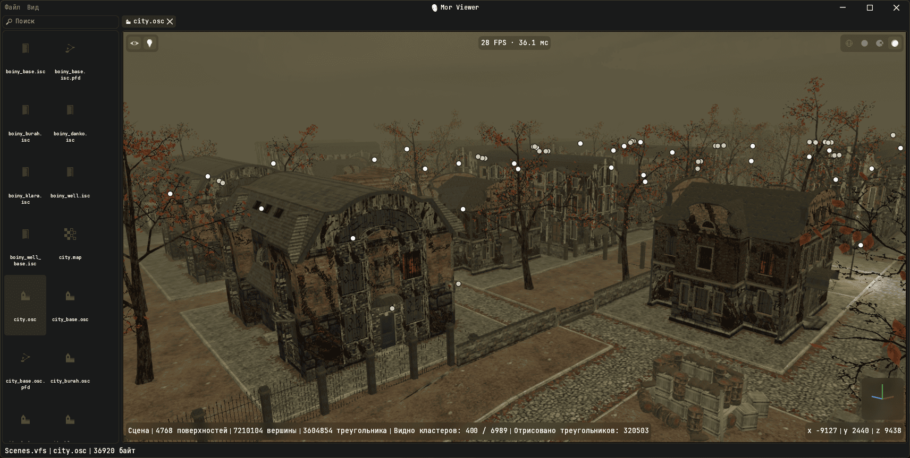
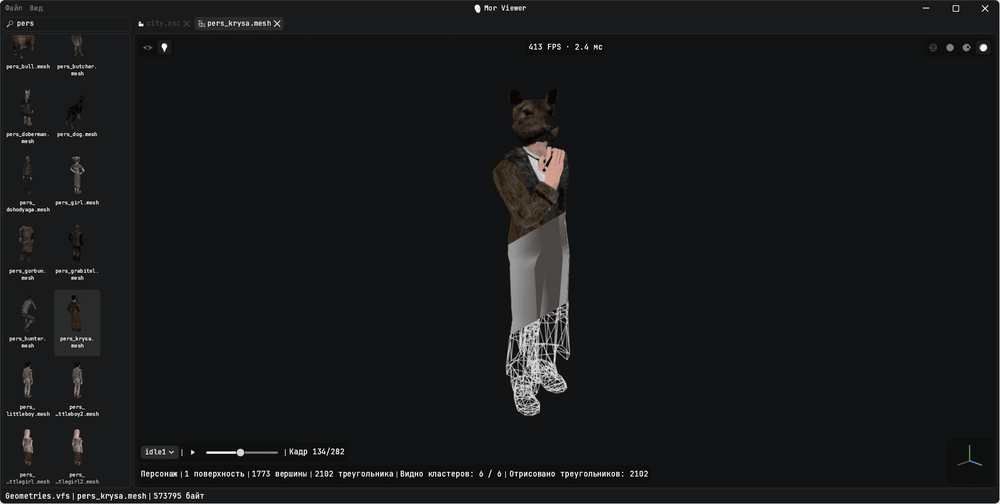
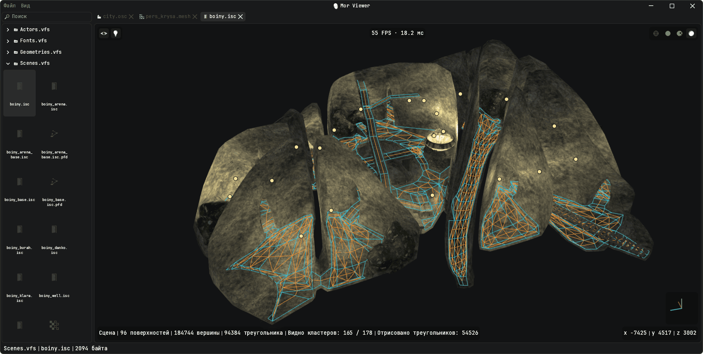
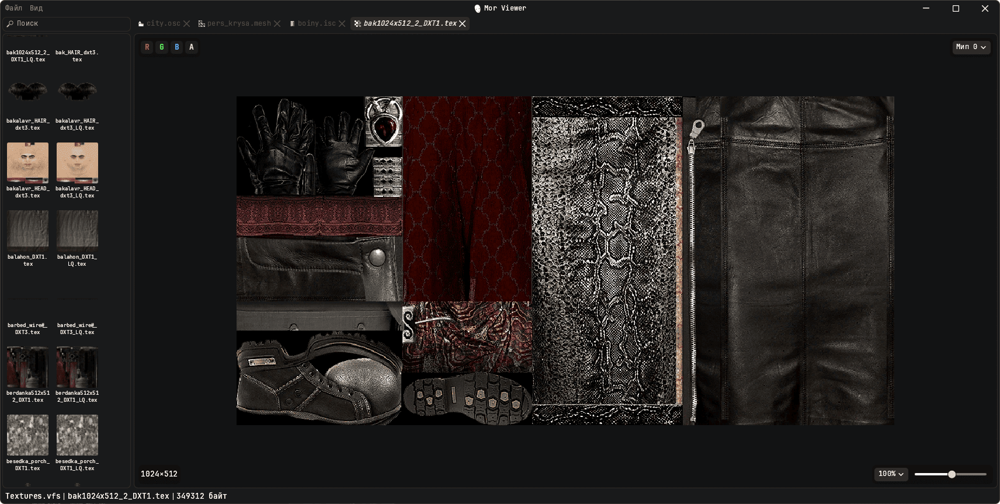
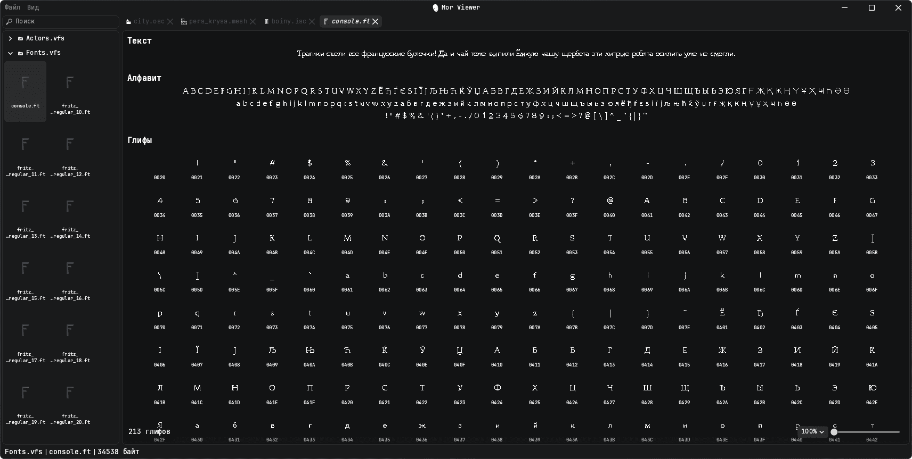

# Mor Viewer

[Русский](README.md) | **English**

Resource viewer for the game "Pathologic" ("Мор. Утопия").


<p align="center"><b>City view</b></p>

| Model view | Interior view |
| -             | -             |
|  |  |

| Textures view | Fonts view |
| -             | -             |
|  |  |

[Desing on Figma](https://www.figma.com/design/zJDOhI3dZ83jExdDrxlsDf/Mor-Viewer?t=G1sQ7JZUY19zUTEY-1)

## Features

| Type | Extensions | What it does |
|---|---|---|
| Textures | `.tex`, PNG, JPEG, TGA | view by channel and zoom, export to PNG |
| Fonts | `.ft` | glyph atlas and sample text |
| Models | `.mesh`, `.mms`, `.mma`, `.lsh` | 3D view, character animations, export to glTF |
| Scenes | `.isc`, `.osc` | whole interiors and levels: lightmaps, light sources, water, sky and time of day, navigation paths |
| Maps | `.map` | map with labels |
| Text | `.xml`, `.txt`, `.json` | syntax highlighting |
| Audio | `.ogg` | playback |
| Other | any | hex view, export as is |

The interface is available in Russian and English.

## Minimum requirements

| Item | Description |
|---|---|
| OS | Windows 10 or later (64-bit), Linux, macOS 11 or later |
| Graphics API | Vulkan (Windows, Linux) or Metal (macOS); OpenGL and DirectX 12 are not supported |
| GPU | with a Vulkan driver and textures up to 8192 pixels: NVIDIA GeForce GTX 600, AMD Radeon HD 7000, Intel HD Graphics 500 or newer; on macOS - any Mac with Metal |
| Data | files of the game "Pathologic" (2005): the installation folder or its VFS archives |

## Usage

```sh
mor-viewer [data_folder | archive.vfs | game_file]
```

Without an argument, the path is taken from the `PATHOLOGIC_DATA` environment variable.

Individual game files (`.mesh`, `.tex`, `.ft`, `.isc` and others) open directly, without an archive: via "File → Open files...", as a command-line argument, or by dragging them into the window. *Each one opens in its own tab and does not appear in the tree. A model looks for its textures among the open files and in the archives: if a texture is opened together with the model, it is applied, otherwise the model is shown without it.*

By default, only `.vfs` archives are opened from the `data` folder. Unpacked files are enabled by the "Load unpacked folders" option in the settings, on the "Game" page:

- **`data` folder** - all folders next to the archives open along with them, for example both `Actors.vfs` and the unpacked `Actors/`. When a model or scene references a file by name, it is looked up in the unpacked folders first and then in the archives, so edited files are picked up right away;
- **folder without archives** - opens whole as unpacked: `.mesh`, `.tex`, `.ft` and the rest lie in it as is.

## Building

Format parsers come from the [Mor-parser](https://github.com/Michael-Soyka/Mor-parser) repository, Cargo fetches them automatically:

```sh
cargo run --release
```

Local development is supported, just add to `.cargo/config.toml`:

```toml
[patch."https://github.com/Michael-Soyka/Mor-parser"]
morft    = { path = "../mor-parsers/crates/morft" }
mormesh  = { path = "../mor-parsers/crates/mormesh" }
morscene = { path = "../mor-parsers/crates/morscene" }
mortex   = { path = "../mor-parsers/crates/mortex" }
morvfs   = { path = "../mor-parsers/crates/morvfs" }
```

## Structure

```
src/
  main.rs, app.rs   startup and main window
  settings.rs       settings
  i18n.rs           localization (strings in locales/)
  data/             archives, file type detection, decoding, export
  render/           GPU: models, culling, water, sky, animation, scene loading
    shaders/        WGSL shaders
  ui/               theme, widgets, icons, window title bar
  viewer/           viewers by file type
    model/          3D viewer: camera, menus, overlays
```
